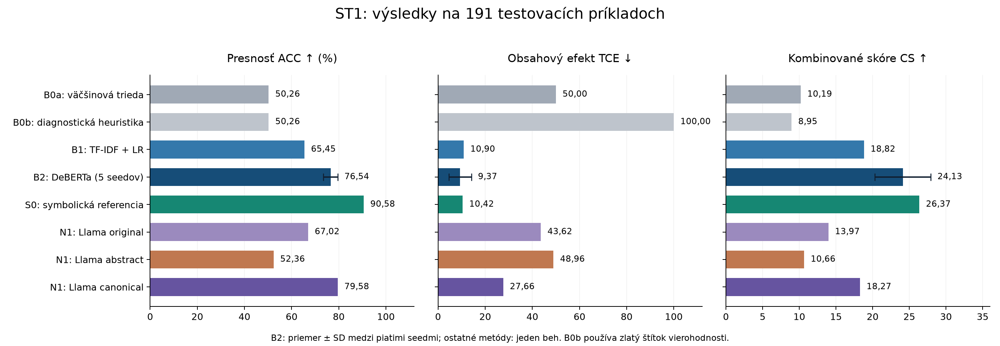
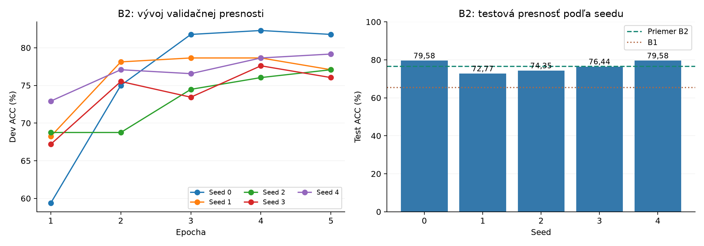
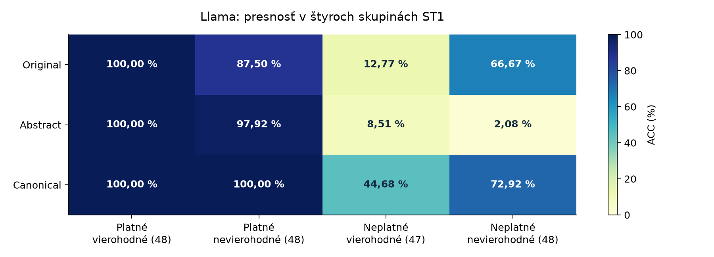

# SemEval-2026 Task 11 (ST1) – baseline (Etapa 1)

Projekt z predmetu Spracovanie prirodzeného jazyka. Úloha: predikcia **logickej platnosti** sylogizmu nezávisle od
**vierohodnosti** obsahu. Hlavná podúloha: ST1 (EN, binárna klasifikácia). ST2 slúži ako test odolnosti.

Stav: **Etapa 1 hotová pre B0 a B1.** B2 (doladený enkóder) a N1 (Llama) boli spustené v Colabe;
výsledky a ich kontrola sú doplnené nižšie. ST3 a ST4 zatiaľ neboli vyhodnotené.

## Rýchly štart

```bash
pip install -r requirements.txt
python -m pytest -q tests          # testy pipeline, parsera a neurónovej infraštruktúry
python -m src.train                # B0 + B1 -> outputs/baseline_results.json
python -m src.diagnostics          # diagnostika B1 -> outputs/diagnostics.json
```

Dáta sú skopírované z oficiálneho repozitára (commit `6f71ea8`, https://github.com/neuro-symbolic-ai/semeval_2026_task_11)
do `data/raw/`. Oficiálne hodnotiace skripty sú nezmenené v `src/vendor/`.
Modelové pipeline a experimentálny postup sú implementáciou projektu; nejde o hotový model organizátorov.

## Metodika (stručne)

* 960 tréningových príkladov -> 766 train / 192 dev (stratifikované podľa 4 buniek validity x plausibility, seed 42).
  Z trénovacích dát sa odstránia 2 texty, ktoré sú aj v teste. Test ST1 má 191 príkladov, ST2 má 190.
* Hyperparametre B1 sa volia **5-násobnou CV na train** (pooled out-of-fold). Dev je kontrolná množina, test sa
  vyhodnocuje po refite na train+dev. Vybraná konfigurácia: `char_wb`, n-gramy (2,4), `C=100`.
* B2: 5 seedov, 5 epoch; tréning na train, výber epochy podľa dev ACC (pri zhode skoršia).
  Na rozdiel od B1 sa pred testom nerefitoval na train+dev.
* Metriky: oficiálne ACC, TCE a CS = ACC/(1+ln(1+TCE)); k tomu 95 % bootstrap CI (5000 resamplov), presný McNemar
  a „šumové dno“ TCE (`evaluate.tce_noise_floor`).
* Testovacie štítky sú verejné; disciplína „test iba raz“ je **procedurálna**. Reprodukcia a analýza chýb už test použili;
  ďalšie úpravy treba vyvíjať na train/dev a označiť ako nový experiment.
  Prvý beh (výber podľa dev) je uložený v `outputs/baseline_results_run1_dev_selection.json`.

## Štruktúra

`src/` data_loader, preprocessing, baselines, evaluate, predict, train, diagnostics, finetune_encoder (B2), run_llama (N1) ·
`configs/experiment.yaml` · `tests/` · `outputs/` (vrátane `neural/`) · `reports/` (správa + príloha o AI) ·
`docs/figures/` (grafy výsledkov).

## Neuro-symbolický baseline N1 (parser -> abstrakcia -> LLM)

* `src/symbolic.py` - vlastný regex tokenizér, typovanie výrokov (A/E/I/O), identifikácia termov, abstrakcia (X, Y, Z), tabuľka platnosti (256 modelov, 24 platných foriem).
* `src/neurosymbolic.py` - reprezentácie vstupu (original / abstract / canonical), zero-shot prompt (v1, SHA-256 uložený), extrakcia odpovede.
* `src/run_llama.py` - inferencia Llama 3 8B Instruct, NF4 4-bit, greedy decoding, najviac 8 nových tokenov;
  výsledky sú v `outputs/neural/llama/`. Ak parser zlyhá, použije sa pôvodný text.
* `python -m src.run_parser_eval` - pokrytie parsera a presnosť symbolického rozhodnutia -> `outputs/parser_eval.json`, `outputs/neurosymbolic_items_*.jsonl`.
* `outputs/parser_audit.json` - pôvodný ručný audit 25 nezhôd (jeden hodnotiteľ).

V N1 rozhoduje o platnosti Llama. Samostatná referencia **S0** rozhoduje symbolicky; nespracované príklady označí za neplatné.
Pravidlá parsera boli podľa pôvodného protokolu ladené na train+dev; reprodukcia ich nemenila.

## Lokálna reprodukcia na Windows

Spustite `powershell -ExecutionPolicy Bypass -File .\reproduce.ps1` v tomto priečinku.
Skript vytvorí `.venv`, nainštaluje uzamknuté závislosti, stiahne dáta z presného
commitu `6f71ea846770f9418c7d2845ec6c25e59f885bd7` a overí zhodu oboch evaluatorov.
Následne spustí testy, B0/B1, diagnostiku a symbolickú časť S0.

Pôvodné výsledky zostávajú v `reproduction/reference/`, nové sú v `outputs/`.
Logy sú v `reproduction/logs/`, SHA-256 zdrojov v `reproduction/data_manifest.json`,
porovnanie v `reproduction/comparison.json` a skutočné verzie v `requirements-reproduced.txt`.
Historický prvý beh a ručný audit sa znovu nevytvárajú. B2 a LLM časť N1 sa týmto skriptom nespúšťajú.

Pre GPU experimenty: [Colab notebook](colab/SemEval_B2_Llama.ipynb), [balík projektu](colab/semeval_colab.zip),
[návod B2/N1](reports/etapa2_navod.md). Pri novom behu použite nový výstupný adresár, aby zostali publikované výsledky zachované.

## Výsledky B0 až N1

B0a = väčšinová trieda; B0b = vierohodnosť ako platnosť (**diagnostika so zlatým štítkom**, nie použiteľný model);
B1 = TF-IDF + logistická regresia; B2 = DeBERTa-v3-base; S0 = symbolická referencia; N1 = Llama 3 8B Instruct.

Dev: **192 príkladov**, test ST1: **191 príkladov**. ACC je v percentách (vyššie je lepšie),
TCE meria nerovnomernosť úspešnosti podľa platnosti aj vierohodnosti (nižšie je lepšie), CS ich kombinuje (vyššie je lepšie).
Pri B2 uvádzame priemer ± výberovú SD medzi piatimi seedmi; SD nie je 95 % interval spoľahlivosti.

<!-- BEGIN RESULTS -->
| Model | Dev ACC ↑ | Dev TCE ↓ | Dev CS ↑ | Test ACC ↑ | Test TCE ↓ | Test CS ↑ |
| --- | --- | --- | --- | --- | --- | --- |
| B0a · väčšinová trieda | 50,00 | 50,00 | 10,14 | 50,26 | 50,00 | 10,19 |
| B0b · vierohodnosť = platnosť | 50,52 | 100,00 | 9,00 | 50,26 | 100,00 | 8,95 |
| B1 · TF-IDF + LR | 67,71 | 9,09 | 20,44 | 65,45 | 10,90 | 18,82 |
| B2 · DeBERTa, priemer ± SD | 78,96 ± 2,04 | 6,40 ± 1,70 | 26,59 ± 1,89 | 76,54 ± 3,06 | 9,37 ± 4,77 | 24,13 ± 3,81 |
| S0 · symbolická referencia | 90,10 | 9,40 | 26,97 | 90,58 | 10,42 | 26,37 |
| N1 · Llama / original | 64,06 | 44,68 | 13,29 | 67,02 | 43,62 | 13,97 |
| N1 · Llama / abstract | 53,12 | 47,87 | 10,87 | 52,36 | 48,96 | 10,66 |
| N1 · Llama / canonical | 66,67 | 38,32 | 14,27 | 79,58 | 27,66 | 18,27 |
<!-- END RESULTS -->



* B2: priemer test ACC **76,54 %**, oproti B1 **+11,10 p. b.**
* N1 canonical: **79,58 %**, oproti original **+12,57 p. b.** Pre vyššie TCE má však nižšie CS než B1 (18,27 vs. 18,82).
  Samotný rozdiel CS nedokazuje štatisticky významnú prevahu.
* N1 abstract: **52,36 %**; jednoduché nahradenie pojmov symbolmi v tomto nastavení nepomohlo.
* S0: **90,58 %** na celom teste. Parser spracoval 160/191 príkladov, na nich bola ACC 158/160 = **98,75 %**.

### B2: jednotlivé seedy

<!-- BEGIN SEEDS -->
| Seed | Vybraná epocha | Dev ACC | Test ACC | Test TCE | Test CS |
| --- | --- | --- | --- | --- | --- |
| 0 | 4 | 82,29 | 79,58 | 7,58 | 25,27 |
| 1 | 3 | 78,65 | 72,77 | 3,12 | 30,11 |
| 2 | 5 | 77,08 | 74,35 | 11,46 | 21,11 |
| 3 | 4 | 77,60 | 76,44 | 8,67 | 23,39 |
| 4 | 5 | 79,17 | 79,58 | 16,00 | 20,76 |
<!-- END SEEDS -->



Všetky seedy prekonali B1 v ACC. Seed 0 má najvyššiu dev ACC; seed 1 má najvyššie testové CS,
ale seed nesmieme vyberať podľa testu. Priemerné CS je priemer skóre jednotlivých behov.
Nastavenie: learning rate `2e-5`, dávka 4 × akumulácia 4, max. 256 tokenov, FP16, checkpointing `use_reentrant=False`.

### N1: rozklad chýb

<!-- BEGIN CELLS -->
| Llama vstup | Platné / vierohodné (48) | Platné / nevierohodné (48) | Neplatné / vierohodné (47) | Neplatné / nevierohodné (48) | Predikcie platný |
| --- | --- | --- | --- | --- | --- |
| original | 100,00 | 87,50 | 12,77 | 66,67 | 147 / 191 |
| abstract | 100,00 | 97,92 | 8,51 | 2,08 | 185 / 191 |
| canonical | 100,00 | 100,00 | 44,68 | 72,92 | 135 / 191 |
<!-- END CELLS -->



* Canonical správne rozpoznal všetkých 96 platných, ale iba 56/95 neplatných argumentov.
  Abstract rozpoznal iba 5/95 neplatných a celkovo predikoval „platný“ 185-krát.
* Na 31 nespracovaných príkladoch dostali všetky varianty rovnaký pôvodný text a mali rovnaké odpovede (ACC 64,52 %).
  Na 160 spracovaných príkladoch bola ACC original / abstract / canonical **67,50 / 50,00 / 82,50 %**.
* Pri abstrakcii sa našli poškodené vety, napr. `All trees are plants without exception.` -> `All Z are X exception.`.
  Slabý výsledok preto nemožno pripísať iba Llame. Tento príklad nie je odhadom frekvencie poškodenia ani dôkazom príčiny všetkých chýb.
* Príklad chyby: „Niektoré cicavce sú živočíchy. Všetky psy sú cicavce. Preto sú všetky psy živočíchy.“
  Argument je neplatný, ale všetky varianty Llamy odpovedali „platný“. B1 a všetky seedy B2 odpovedali správne.
  Originály, ID a ďalšie ukážky: [error_examples.json](reports/neural_results_review/error_examples.json).

### Doplnková diagnostika B1

Samostatné experimenty na dev (`C=10`, word 1–2 alebo char_wb 2–4); nejde o finálny model B1 ani testové výsledky.

<!-- BEGIN DIAGNOSTICS -->
| Vstup B1 | Analyzátor | Dev ACC | Dev TCE |
| --- | --- | --- | --- |
| full | word | 67,19 | 7,69 |
| full | char_wb | 66,15 | 10,88 |
| premises_only | word | 64,58 | 6,67 |
| premises_only | char_wb | 64,58 | 7,03 |
| conclusion_only | word | 71,88 | 2,81 |
| conclusion_only | char_wb | 72,40 | 7,67 |
<!-- END DIAGNOSTICS -->

Úspešnosť aj bez premís naznačuje využívanie povrchových signálov. Nie je dôkazom logického odvodzovania.

### ST2: referencia odolnosti

B1 predikuje platnosť; pri „platný“ sa náhodne vyberú dve premisy, pri „neplatný“ je výber prázdny.

<!-- BEGIN ST2 -->
| Metóda | n | ACC | F1 premís | TCE | CS |
| --- | --- | --- | --- | --- | --- |
| B1 + náhodný výber premís | 190 | 65,26 | 23,68 | 10,23 | 13,01 |
<!-- END ST2 -->

ST2 používa CS = `((ACC + F1) / 2) / (1 + ln(1 + TCE))`. Nejde o naučený výber relevantných premís.
B2/N1 zatiaľ nemajú výsledky ST2; ST3/ST4 neboli vyhodnotené.

### Kontrola a zdroje výsledkov

* [B0/B1](outputs/baseline_results.json), [S0](outputs/parser_eval.json), [B2/N1](outputs/neural),
  [presný súhrn](outputs/results_summary.json). Neurónové predikcie sú pôvodné exporty z Colabu.
* Audit prepočítal 16 neurónových vyhodnotení (5 seedov B2 × dev/test + 3 varianty N1 × dev/test)
  bez zistených nezrovnalostí v kontrolovaných metrikách, ID, hashoch dát, exportoch a výbere epochy.
* Exploračný McNemarov test canonical vs. original: 28 opravených a 4 pokazené príklady,
  `p=0.0000193`; po Holmovej korekcii troch porovnaní `p=0.0000386`. Podrobnosti: [audit.json](reports/neural_results_review/audit.json).
* Audit kontroluje predikcie, nie nezávislú GPU reprodukciu. Archív neobsahuje váhy, kompletné logy ani snapshot kódu;
  absenciu ladenia podľa testu z neho nemožno dokázať. Závery platia pre uvedené modely, prompt a NF4 nastavenie.
* [PDF súhrn](output/pdf/SemEval_ST1_vysledky.pdf) · [Podrobná interpretácia](reports/neural_results_review/vysledky_a_interpretacia.md).

Tabuľky a grafy obnoví `python update_results_readme.py` z uložených JSON súborov bez tréningu.
Pôvodný archív skontroluje `python audit_neural_results.py`. Staršie správy zachovávajú historický stav projektu.
